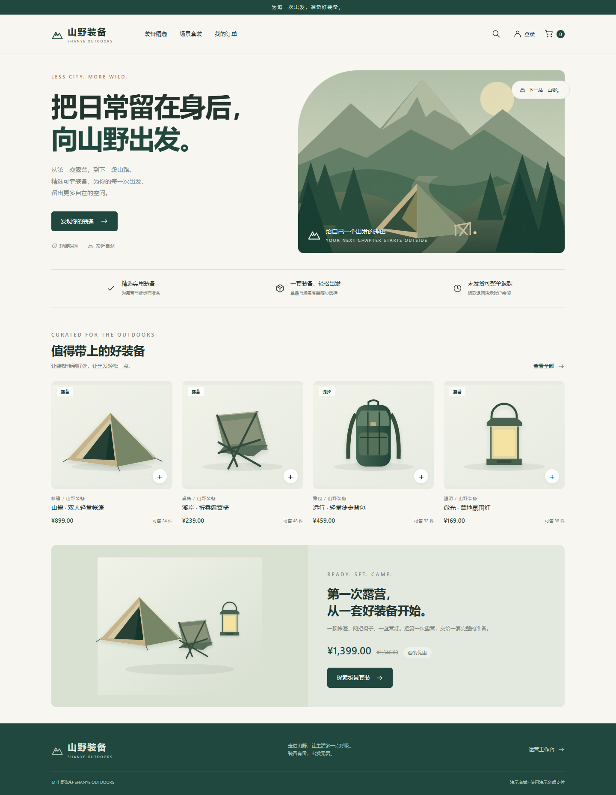
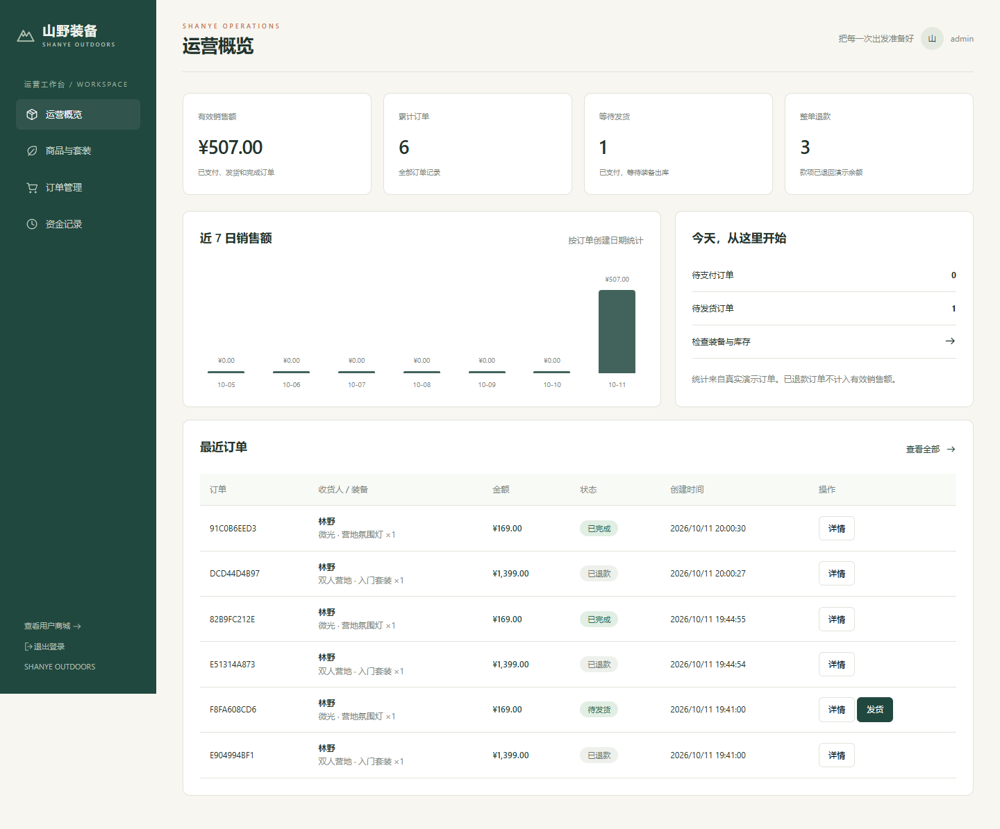

# 山野装备 · 户外装备商城

面向 Java 后端求职展示的自营商城。用户端、管理后台与六个独立 Java 进程，使用固定套装与单品共享库存，完成下单、演示余额支付、取消、超时关单、整单退款、发货和收货。



## 本机启动

需要 JDK 17 和 Maven；Node 用于验证脚本。首次使用先准备 JDK，再构建源码。

在项目根目录的 PowerShell 中运行：

```powershell
# 换一台电脑时，可下载项目内的便携 JDK，不改系统 Java。
.\scripts\prepare.ps1
.\scripts\build.ps1
.\scripts\start.ps1
```

用户端：<http://127.0.0.1:8080/>。管理端：<http://127.0.0.1:8080/admin/>。

| 演示账户 | 密码 | 用途 |
| --- | --- | --- |
| demo | Shanye123! | 普通用户，初始演示余额 ¥5,000 |
| admin | ShanyeAdmin123! | 商品、套装、订单与资金记录管理 |
| lowbalance | Shanye123! | 余额不足场景，初始余额 ¥1 |

页面提供“填入演示账户”按钮。余额是演示数据，后端执行真实的余额校验、扣减、退款与账本去重。

停止当前项目进程：

```powershell
.\scripts\stop.ps1
```

脚本只停止启动记录中的 Java 进程，保留数据。源码修改后先停止再构建，以免 Windows 锁住运行中的 JAR。

默认采用每个模块独立的 H2 文件数据库（`.data/user`、`item`、`cart`、`trade`、`pay`），重启后数据保留。不会连接或修改本机已有的 MySQL 数据库。首次启动创建表和演示数据，后续启动不会覆盖已修改的商品、余额或订单。

## 模块与数据归属

| 模块 | 默认端口 | 职责和自己的数据库 |
| --- | --- | --- |
| hm-gateway | 8080 | Spring Cloud Gateway 路由、鉴权、两端静态页面 |
| user-service | 8081 | 账户、角色、地址、余额和幂等资金账本 |
| item-service | 8082 | 商品、套装组件、可售与预留库存、库存操作记录 |
| cart-service | 8083 | 用户购物车 |
| trade-service | 8084 | 订单、价格和组件快照、履约、持久化操作恢复 |
| pay-service | 8085 | 支付、退款和事务性 Outbox 通知记录 |
| hm-common | 无 | JDBC 事务、内部请求、令牌验证与统一错误处理 |

业务源码位于各模块 `com.hmall.outdoor` 包，应用使用 `outdoor.yml`。仓库包含当前山野装备业务源码；历史教学源码、旧环境配置和证书未包含在公开版本中。

前端主源码位于 `frontend/`，使用普通 HTML、CSS、JavaScript 和本地 SVG；修改后无需打包。网关直接提供两端页面，也可通过同步脚本发布到自己的 Nginx 目录。

## 核心规则

- **共享组件库存**：例如露营套装包含帐篷×1、椅子×2、营灯×1。订单混购套装和单品时先汇总组件需求，在商品模块的单个本地事务中按确定顺序锁定组件、检查并预留，任一组件不足则全部回滚。
- **库存生命周期**：预留时减少可售库存、增加预留库存；付款确认后减少预留库存、增加销量；取消释放预留；退款恢复可售库存并减少销量。按订单号保存状态，重复调用不会重复操作。
- **下单幂等**：同一用户和 `requestKey` 唯一；相同编号提交不同内容被拒绝。名称、价格、数量、套装组成及地址均保存快照，不接受客户端提供的价格。
- **15 分钟有效期**：待支付订单过期后自动进入关闭操作；支付与关单通过订单行锁选择唯一状态分支，支付处理中不被关单线程抢走。
- **余额幂等**：资金账本使用唯一操作编号。扣减 SQL 带余额充足条件，与账本记录在账户模块同一本地事务内提交。
- **恢复和重试**：交易模块先持久化操作状态，再调用其他模块；超时或服务中断后定时恢复。远程操作均幂等，因此远程成功、本地提交前崩溃也可以再次执行。余额不足使订单回到待支付；已确定扣款的操作保持处理中并恢复。
- **可靠通知**：支付状态和 Outbox 记录在同一事务提交，通知失败保存次数和下次重试时间。默认通过内部 HTTP 确认通知；可切换 RabbitMQ 发布确认与持久化队列。
- **退款与发货**：已支付、未发货才能自动整单退款；发货与退款竞争同一订单行锁。退款退回演示余额并恢复组件库存；发货后用户确认收货。
- **权限**：网关和业务模块分别验证签名令牌；后台仅管理员访问，用户操作检查订单归属。网关移除伪造的内部身份头；内部调用需要独立密钥。

这套实现使用本地事务、幂等账本和持久化恢复协作；不宣称使用 Seata 全局事务或 Elasticsearch 搜索。商品搜索和筛选在当前规模的前端目录完成，后台分页上限见 [接口文档](docs/api.md)。

## 演示顺序

1. 登录用户端，查看单品与双人露营套装，加入购物车并下单。
2. 查看共享组件可售库存减少，使用演示余额支付，检查余额收支。
3. 对未发货订单退款，观察余额与库存恢复。
4. 再下一单并付款，管理员填快递公司和单号发货，用户确认收货。
5. 管理端查看真实统计、订单轨迹、支付及通知记录，编辑套装组成。
6. 用低余额账户验证失败路径；并发、超时、故障恢复由独立测试脚本验证。

## 验证

```powershell
# 对已有构建产物运行；测试自行启动 9080–9085 的独立进程和新数据库。
node tests/integration.cjs

# 用户界面测试要求 8080 演示环境已启动，会产生演示订单。
npm ci
node tests/browser.cjs
```

浏览器脚本使用本机 Edge，也支持 `BROWSER_CHANNEL` 切换。脚本原始结果写入忽略目录 `test-results/`，交付记录在 [验证说明](docs/validation.md)。



## MySQL、Nacos 与 RabbitMQ

参见 [部署说明](docs/deployment.md)。`middleware` Maven 配置加入 Nacos 注册依赖；Spring 的 `middleware` 运行配置使用 RabbitMQ 通知。MySQL 使用五个独立库，各模块提供可重复执行的建表资源，演示数据仍由启动逻辑创建。中间件配置与本机演示模式共用相同业务代码。

## 公开源码与配置

本仓库是当前项目的独立公开版本，未上传原始 Git 历史、备份 bundle、数据库文件、运行日志、私有证书或本机 Maven 设置。部署配置仅提供环境变量模板：复制 `deploy/.env.example` 为 `deploy/.env` 并自行填写，真实值由 `.gitignore` 排除。

上面的账户、密码、收货人、手机号和地址均为专门生成的演示数据；本机默认密钥仅用于隔离演示。部署密钥应自行生成并在全部模块保持一致，详见 [部署说明](docs/deployment.md)。

外部资料：[Microsoft OpenJDK 下载](https://learn.microsoft.com/en-us/java/openjdk/download)、[H2 数据库模式](https://h2database.com/html/features.html)、[Playwright 浏览器配置](https://playwright.dev/docs/browsers)。
