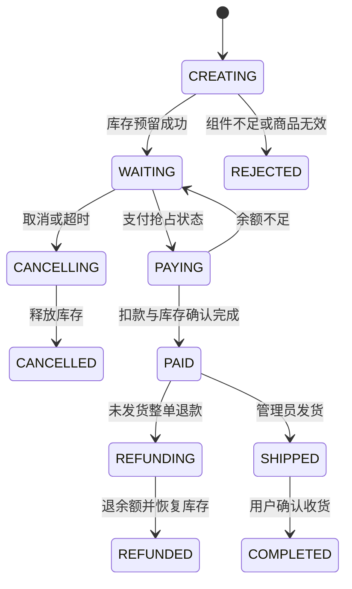

# 接口与业务状态

网关地址 `http://127.0.0.1:8080/api`。除登录、商品公开查询外，需要 `Authorization: Bearer <token>`。错误返回 HTTP 状态码和 `{ "message": "错误说明" }`。

## 用户端

| 方法 | 路径 | 请求和结果 |
| --- | --- | --- |
| POST | /auth/login | username、password；返回 token、id、username、role、balance |
| GET | /account | 当前账户，不返回密码 |
| GET | /account/ledger | 当前账户的扣款与退款账本 |
| GET/POST | /addresses | 列表；新增 recipient、phone、detail |
| GET | /catalog/products | 已上架目录，套装包含 parts、originalPrice、计算后的 stock |
| GET | /catalog/products/{id} | 已上架装备详情 |
| GET/POST/DELETE | /cart | 列表；productId、quantity 设置数量（0 移除）；清空 |
| POST | /orders | requestKey、addressId、lines:[{productId,quantity}] |
| GET | /orders | 当前用户最近 100 条订单，包含快照、地址、事件 |
| GET | /orders/{id} | 本人订单 |
| POST | /orders/{id}/pay | 演示余额支付，空 JSON 请求体 |
| POST | /orders/{id}/cancel | 取消待支付订单 |
| POST | /orders/{id}/refund | 已支付未发货整单退款 |
| POST | /orders/{id}/receive | 确认收货 |

金额单位为分。产品 ID 和订单 ID 为字符串；数量 1–99，同一商品重复行会汇总。单次订单最多 50 行，组件数量最多 99。请求金额不参与服务端计价。

## 管理端

| 方法 | 路径 | 用途 |
| --- | --- | --- |
| GET/POST | /admin/products | 全部商品列表 / 新增或修改商品 |
| GET | /admin/orders | 最近 200 条全部订单 |
| POST | /admin/orders/{id}/ship | carrier、trackingNo；已支付订单发货 |
| GET | /admin/dashboard | 真实订单数、有效销售额、待支付、待发货、退款数与近 7 日统计 |
| GET | /admin/payments | 支付单与 Outbox 通知记录 |

新增/修改商品：id（新增时为空）、name、type（SINGLE/BUNDLE）、price、stock、category、scene、brand、description、spec（对象）、image、status（ACTIVE/INACTIVE）。套装另传 parts:[{itemId,quantity}]；组件必须是单品且不能重复。已有商品不能改变类型。stock 是当前可售库存，预留库存独立维护。

## 状态流转

中间状态持久化，失败后由交易模块扫描恢复。处理中的支付不会被超时关单抢占。所有内部接口位于 `/internal/*`，不经网关公开，需要 `X-Internal-Key`。

当前演示规模：目录返回全部商品；用户/管理员订单分别返回最近 100/200 条。后台统计查询全部订单，日期按服务运行时区。真实大规模部署前应在这些接口引入分页与聚合表；当前实现不包含商家入驻、租赁、部分退款、收货后退货、真实资金支付。
